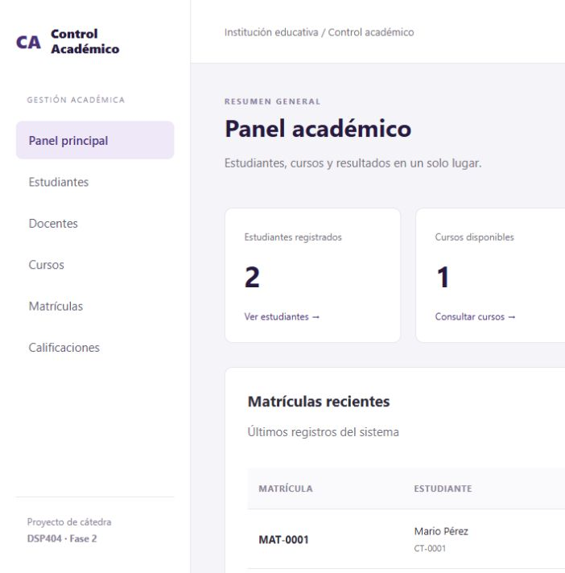
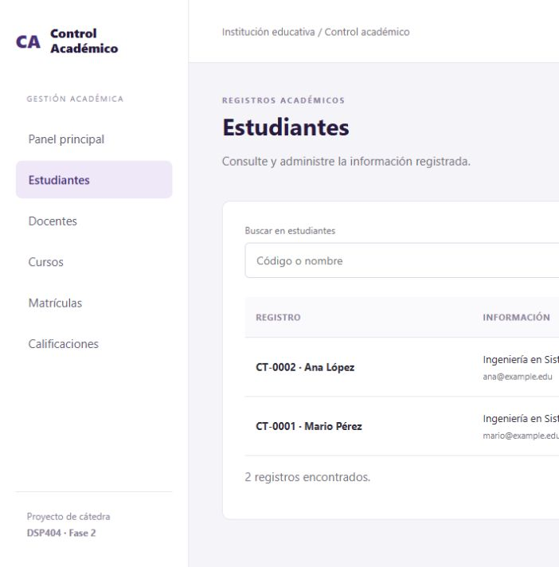
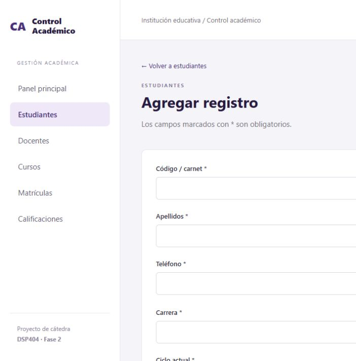
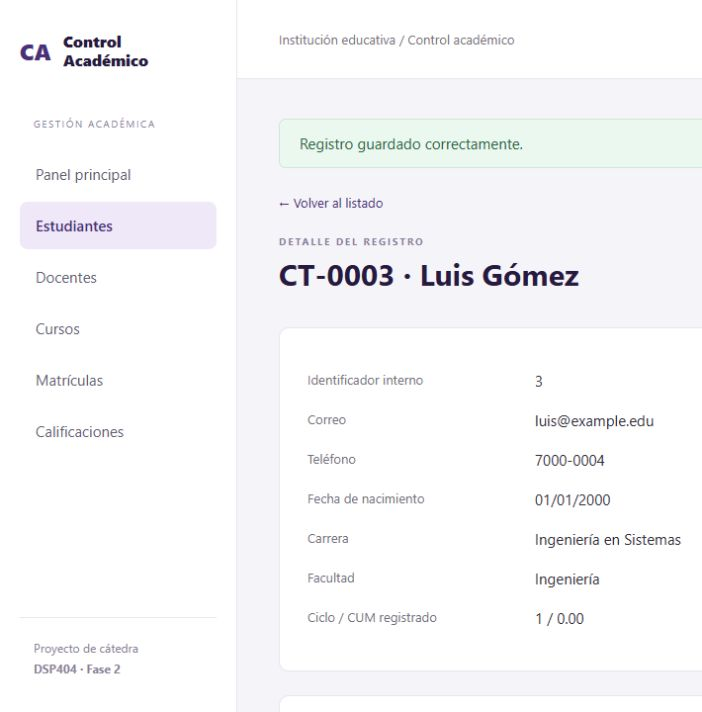

# Sistema de Control Académico

Proyecto de cátedra DSP404, Universidad Don Bosco. Continuación del sistema modelado
en fase 1: estudiantes, docentes, cursos, matrículas y calificaciones.

## Descripción y funcionalidades

Aplicación web ASP.NET Core MVC con Entity Framework Core y base de datos SQLite.
Permite agregar, consultar, editar y eliminar registros de los cinco módulos.
Incluye dashboard con indicadores, búsquedas por nombre/código, formularios,
detalles con relaciones y confirmación de eliminación.

Las matrículas comprueban existencia de estudiante y curso, cupo y duplicados.
Las notas deben estar entre 0 y 10 y corresponden a una matrícula activa.
Una nota desde 6 se considera aprobada. El sistema protege los registros con
dependencias, controla ediciones obsoletas y presenta mensajes de error.

## Diseño en capas

```text
Presentación:  ControlAcademico.Web       Controladores MVC, vistas Razor y API
Negocio:       ControlAcademico.Negocio   Casos de uso, validaciones y reglas
Datos:         ControlAcademico.Datos     EF Core, SQLite y transacciones
Dominio:       ControlAcademico.Dominio   Entidades de fase 1 y contrato del repositorio
```

Los controladores consultan la capa de negocio y no ejecutan SQL ni acceden al
DbContext. El arranque registra las dependencias. El dominio de fase 1 se conserva
y sus constructores se reutilizan para validar estudiantes, docentes y cursos.
Los registros de persistencia mantienen separada la representación de la BD.
La consola y sus pruebas siguen disponibles como antecedente ejecutable.

## Tecnologías

C#, .NET 10, ASP.NET Core MVC, Razor, Entity Framework Core 10.0.12, SQLite,
HTML, CSS y GitHub Actions. Para las pruebas HTTP se utiliza Python 3 sin paquetes adicionales.

## Instalación y ejecución

Requisitos: SDK .NET 10 y acceso a NuGet en la primera restauración.
Desde la raíz del repositorio:

```sh
dotnet restore ControlAcademico.slnx
dotnet build ControlAcademico.slnx --configuration Release
dotnet run --project src/ControlAcademico.Web --configuration Release --no-build -- --urls http://localhost:5188
```

Abrir **http://localhost:5188** en Chrome. La primera ejecución crea automáticamente
`src/ControlAcademico.Web/App_Data/academico.db`, las tablas y los ejemplos.
Los datos continúan disponibles después de cerrar y reiniciar la aplicación.
No hay que instalar un servidor SQL. La base se crea con `EnsureCreated`;
el esquema inicial también se documenta en `database/esquema.sql`.
Esta versión no incluye migraciones incrementales de esquema.

Los ejemplos usan datos ficticios: docente DOC-001, estudiantes CT-0001 y CT-0002,
curso DSP404, matrícula MAT-0001 y nota 8.5. El CUM se registra manualmente y
no se calcula automáticamente a partir de las notas.

La opción `Academico:Archivo` permite elegir otra ruta de BD. Para no sembrar
ejemplos, usar `Academico:SembrarDatos=false`. SQLite y las claves antiforgery locales
están excluidos de Git. El flujo previsto es una demostración académica local,
sin autenticación de usuarios; no se proporciona alojamiento público.

## Cómo probar las funciones

1. En **Docentes**, agregar, editar y consultar un docente de prueba.
2. En **Estudiantes**, agregar un estudiante con carnet único y correo válido.
3. En **Cursos**, crear un curso asignado al docente y con cupo 1.
4. En **Matrículas**, inscribir al estudiante. Intentar repetirlo: se debe rechazar.
5. Intentar inscribir otro estudiante en el mismo curso: no debe superar el cupo.
6. En **Calificaciones**, registrar y editar una nota. Una nota 25 debe rechazarse.
7. Reiniciar la aplicación y comprobar que permanecen los registros.
8. Eliminar en este orden: nota, matrícula, curso, estudiante y docente. Los registros
   relacionados se protegen hasta que se resuelven sus dependencias.

La cancelación se realiza editando el estado de una matrícula sin nota. Libera cupo;
la eliminación física tiene una pantalla de confirmación separada.

## Servicio web

```http
GET /api/estudiantes/CT-0001/situacion
```

Devuelve JSON con carnet, nombre y matrículas: curso, estado, nota y resultado.
No devuelve correo, teléfono ni fecha de nacimiento. Si no existe el estudiante,
responde 404; si falla el acceso a datos, responde 503 con un mensaje controlado.
Para probarlo, abrir http://localhost:5188/api/estudiantes/CT-0001/situacion en Chrome.

## Pruebas

Después de compilar en Release:

```sh
dotnet run --project tests/ControlAcademico.Pruebas --configuration Release --no-build
dotnet run --project tests/ControlAcademico.Integracion --configuration Release --no-build
python tests/verificar_web.py
```

Se verificaron 14 casos del dominio, 22 comprobaciones con SQLite y los flujos HTTP
de 25 páginas, CRUD, validaciones, antiforgery, API y persistencia tras reinicio.
Los ejecutables de pruebas no usan `dotnet test`. Ver `docs/VALIDACION-FASE2.md`.

## Capturas del sistema

Capturas reales de la ejecución local, no de los bocetos HTML:

### Panel principal


### Listado


### Formulario


### Detalle


## Integrantes registrados en fase 1

| Integrante | Carnet |
|---|---|
| Marcelo Eduardo Guerrero Rodriguez | GR241968 |
| Daniela Jazmin Torres Ramos | TR232197 |
| José Miguel Sosa Ayala | SA251597 |
| Susana Nicole Valle Méndez | VM253306 |
| Alessandra Guadalupe González Burgos | GB253116 |

Se conserva el equipo consignado en el material de fase 1; la participación y defensa
individual deben ser confirmadas por el equipo.

## Continuidad y entrega

El prototipo original recibido está en `referencia/ControlAcademico-Fase1-original.zip`.
Su origen es `marceloguerrero-debug/ControlAcademico`, rama `1-main`.
Esta ampliación se prepara sobre la copia indicada por el usuario en
`HISTOR126/ControlAcademico-Fase2.`.

**El enunciado exige el mismo repositorio de fase 1. Esta copia es otro repositorio:**
el equipo debe incorporar la ampliación al repositorio original de entrega o confirmar
con el docente la aceptación de este destino. Copiar archivos no conserva el historial Git original.

Documentos de apoyo: `docs/ARQUITECTURA-FASE2.md`, `docs/GUIA-DEFENSA-FASE2.md`,
`docs/REQUISITOS-FASE2.md` e `Informe-Fase2-ControlAcademico.pdf`.
La entrega en aula virtual y la defensa presencial corresponden al equipo.
