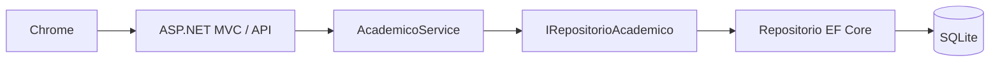
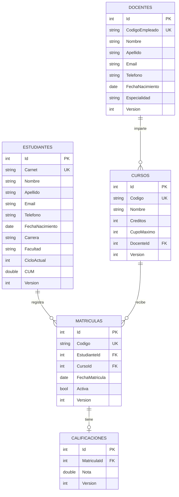

# Arquitectura y modelo de datos de fase 2

## Flujo de una petición

La presentación enlaza rutas, muestra vistas y valida el modelo de entrada. Negocio
valida los casos de uso y emplea el contrato del repositorio. Datos implementa
lecturas y escrituras de EF Core. Solo el arranque de la web configura el DbContext;
ninguna vista ni controlador consulta directamente la BD.

## Continuidad con fase 1

Persona, Estudiante, Docente, Curso, Matrícula, Calificación y las interfaces del
prototipo se mantienen. El servicio en memoria continúa para la consola. La web
añade un servicio persistente y registros de almacenamiento. Para validar datos
de personas y cursos reutiliza los constructores originales. Los cupos de la web
se calculan desde las matrículas activas, evitando duplicar un contador persistido.

## Modelo relacional

Índices únicos para códigos, carnet, matrícula activa estudiante-curso y nota por
matrícula. Claves foráneas con borrado restringido. Restricciones de rango en notas,
CUM, créditos y cupos. El SQL correspondiente está en `database/esquema.sql`.

## Escritura y errores

Cada modificación utiliza una transacción SQLite serializable: lee, valida, modifica
y guarda como una sola unidad. Una excepción revierte la operación. Version detecta
formularios que se editaron en otra sesión. Los conflictos y errores de BD se
traducen en mensajes controlados; no se muestran trazas ni cadenas de conexión.
Los formularios POST tienen protección antiforgery, comprobaciones HTML y validación
en servidor. La API de consulta no modifica información.

## Alcance y límites

Aplicación académica local para un volumen pequeño: el repositorio carga las tablas
para validar relaciones. No incluye paginación, cuentas de usuario, distribución por
períodos, evaluaciones parciales ni cálculo automático de CUM. Esas funciones no se
establecen en el PDF recibido. Hay una nota final por matrícula.
`EnsureCreated` crea el esquema inicial; futuros cambios de esquema requieren plan
de migraciones y respaldo, no borrar la BD de los usuarios.
