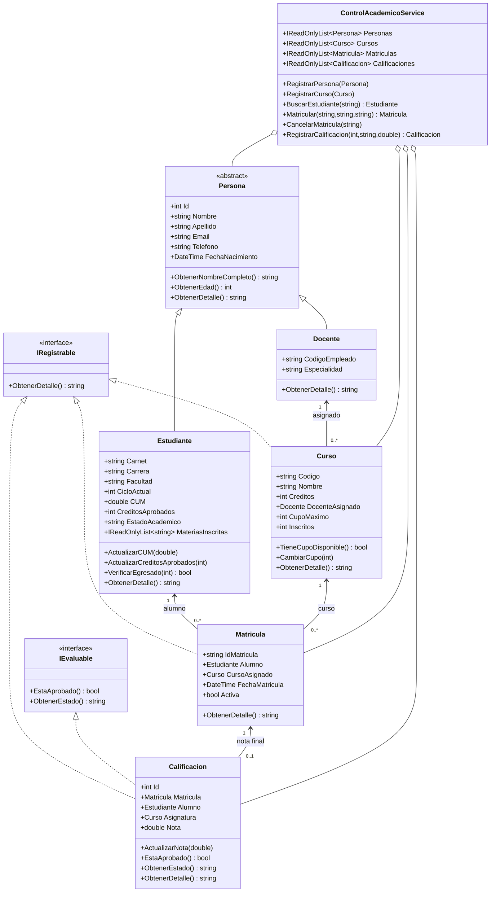

# Diagramas del sistema

El modelo relacional y la arquitectura web de fase 2 están en [ARQUITECTURA-FASE2.md](ARQUITECTURA-FASE2.md).

El siguiente diagrama conserva las clases del dominio de fase 1, utilizadas por la consola y como validación base en la web.

# Diagrama de clases vigente

Las propiedades públicas que no declaran actualización son de solo lectura.
Los constructores de Matrícula y Calificación son internos al dominio.

